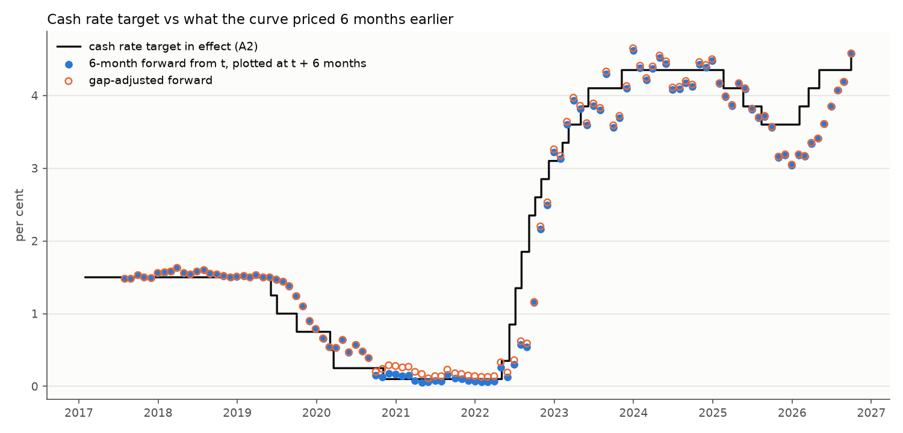
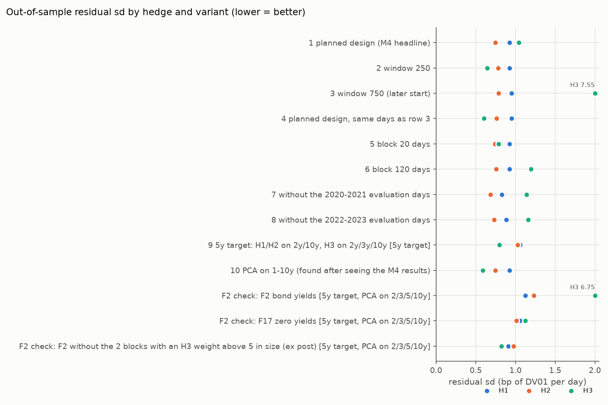

# Does the Australian yield curve predict the RBA?

The RBA publishes a fitted government yield curve every day. This project asks two questions of it, on daily data from January 2017 to September 2026:

1. Do the curve's forward rates predict where the RBA will set the cash rate?
2. When hedging a bond, does a 3-factor model (level, slope, curvature) beat a plain duration hedge on days it has not seen?

Independent project on public RBA data. Not advice. bp = basis point, 0.01 percentage points.

## The short answer

- **Forecasting: better than guessing "no change", but not significantly.** The forward rate's typical error is about half that of "no change" (31 against 67 bp, 6 months ahead), but the gain does not pass a 5% test (p = 0.11). Most of it comes from the 2022-23 hikes.
- **Hedging: the 3-factor hedge lost to duration, because of one bad period.** Over 1,943 out-of-sample days it left more risk than duration (1.04 against 0.93 bp a day). In mid-2019 its curvature factor was so poorly estimated that it took extreme positions; in the other 32 of 33 periods it was the best hedge.
- **A 2-factor hedge (level and slope) beat duration throughout** (0.74 bp a day), with stable weights.

## Data

| RBA table | What it holds | Used for |
|---|---|---|
| F17 | Zero-coupon yields and forward rates, 0-10 years, 2,448 days | Both questions |
| A2 | Cash rate decisions: 26 in the sample (9 cuts, 17 hikes) | What the RBA actually did |
| F1 | Actual cash rate and OIS (overnight index swaps) to Dec 2022 | Benchmark |
| F2 | 2, 3, 5 and 10-year government bond yields | Cross-check |

Before using the curve I checked what it actually contains ([data report](outputs/m1/validation_report.md)). The useful findings:

- F17's forward rates are instantaneous forwards, so each one can be read as the expected cash rate on a single future date.
- The curve's 0-year point is the actual overnight cash rate, not the RBA's target; from 2020 to 2025 it sat 1-12 bp below the target.
- On 14 Feb and 13 Dec 2019 the short end jumps and fully reverses the next day. These look like fitting errors, so I leave them out of the hedging work.

## 1. Does the curve predict the cash rate?

On the last trading day of each month, I take the curve's forward rate 3 and 6 months ahead as the forecast, and compare it with what the target actually was then. The benchmark is "no change": today's target. Each forecast uses only data published by that day's close.

| Horizon | Forward error (RMSE, bp) | "No change" error (bp) | Is the gain significant? |
|---|---|---|---|
| 3 months | 16 | 36 | No (p = 0.08) |
| 6 months | 31 | 67 | No (p = 0.11) |

RMSE is the typical size of a miss. The test is Diebold-Mariano, with standard errors that allow for overlapping forecasts.



- **The misses are at turning points.** Forecasts made in January-March 2022 missed the coming hikes by up to 131 bp, and forecasts made in August-December 2025 missed the 2026 hikes.
- **Most of the gain is one episode.** The 2022-23 hiking cycle supplies 83% of the 3-month improvement.
- **When the curve did move, it moved the right amount.** At 6 months, actual changes rose one-for-one with priced changes (slope 1.01).
- **Against OIS, the market's direct bet on the cash rate,** the curve does just as well over 2017-2022. That is partly built in, because the RBA fits the short end of its curve to OIS. At 1 month OIS is better (4.8 against 6.1 bp).

## 2. Does a 3-factor hedge beat duration?

Three factors explain 98.9% of daily curve moves: level (90%), slope (7%) and curvature (1.5%). I hedge a 7-year zero-coupon position four ways, estimating each hedge on the past 500 days, fixing it for the next 60, then rolling forward (33 periods, January 2019 to September 2026):

| Hedge | Instruments | Leftover risk (bp a day) |
|---|---|---|
| None | | 5.46 |
| Duration | 2y and 10y | 0.93 |
| Level + slope | 2y and 10y | **0.74** |
| Level + slope + curvature | 2y, 5y and 10y | 1.04 |

- **One period decides it.** From late June to mid-September 2019 the curvature factor was barely distinguishable from the next, smaller factor. The hedge equations became unstable (condition number 111, against 7.6 or less in every other period) and the 3-factor hedge did worse than no hedge at all.
- **Elsewhere the 3-factor hedge is best,** leaving 0.60 bp a day over the other 32 periods.
- **The verdict flips with the setup.** With a 250-day estimation window or a 5-year target, the 3-factor hedge beats duration significantly; with a 750-day window it hits its own bad period in 2020. The practical lesson: a factor hedge needs a check on how well its factors are estimated before it is trusted.
- **On real bond yields (F2)** no factor hedge beat duration, but with only four maturities this check is weak.



## What I can't claim

- **Significance.** The forecasting gain is large but not significant over the full sample. The one significant version (leaving out the 2022-23 hikes) was chosen after seeing the results.
- **Small sample.** 26 decisions in four clusters, and about 18 independent 6-month forecasts. Every p-value is rough.
- **A revised, fitted curve.** F17 is the RBA's smoothed curve, revised after the fact, not prices a trader saw in real time. Smoothness may flatter factor hedges.
- **Term premium.** A forward rate mixes the expected cash rate with a premium for holding longer bonds, so a miss is not purely a forecasting mistake.
- **Simple hedging.** Constant maturities, no carry or roll-down, and first-order (DV01) profit and loss.

## Files and how to run

| Script | What it does | Report |
|---|---|---|
| `src/data.py` | Loads the RBA tables | |
| `src/m1_validate.py` | Checks the data | `outputs/m1/validation_report.md` |
| `src/m2_expectations.py` | Forward rates as forecasts | `outputs/m2/expectations_report.md` |
| `src/m3_factors.py` | Level, slope and curvature | `outputs/m3/factors_report.md` |
| `src/m4_hedging.py` | Out-of-sample hedging test | `outputs/m4/hedging_report.md` |
| `src/m5_robustness.py` | OIS benchmark, changed settings, bond-yield check | `outputs/m5/robustness_report.md` |

```bash
pip install -r requirements.txt
python src/m1_validate.py
python src/m2_expectations.py
python src/m3_factors.py
python src/m4_hedging.py
python src/m5_robustness.py
python -m pytest
```

The data files are not in the repo: download them from the URLs in `data/MANIFEST.csv` into `data/raw/`. F1 and F2 hold third-party data, so only statistics from them are published here. The 51 tests check, among other things, that no forecast or hedge uses data from after its own date.

Source: Reserve Bank of Australia, tables F1, F2, F17 and A2.
