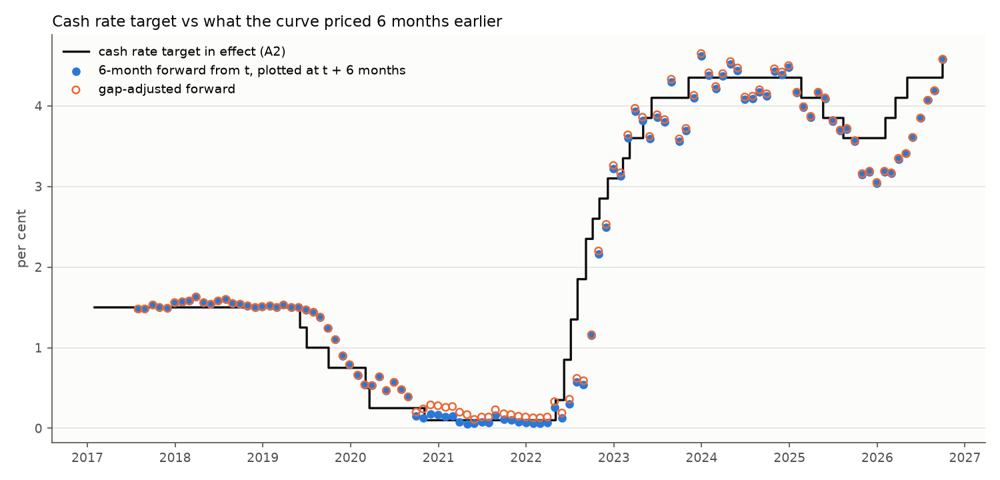
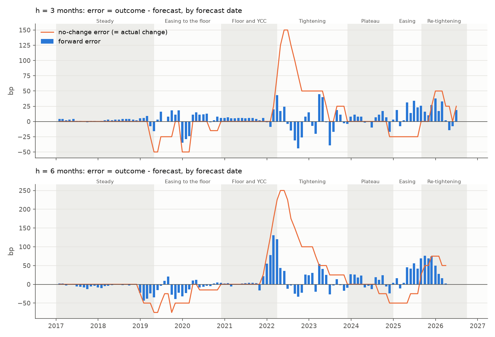

# M2 - Expectations test

Generated by `src/m2_expectations.py`. Forecast dates t: last F17 business day of each month from Jan 2017. Error = outcome - forecast, in bp; positive = target ended above the forecast.

## Answer

Partly.

- **Accuracy.** The F17 forward has a 56% lower RMSE than "no change" at 3 months (16 vs 36 bp) and 54% lower at 6 (31 vs 67 bp).
- **Significance.** Not at 5% over the full sample: Diebold-Mariano p = 0.081 (Newey-West, lag h) to 0.131 (Harvey-Leybourne-Newbold) at 3 months, 0.114 to 0.203 at 6. Tightening forecasts supply 83% of the summed squared-error gain at 3 months; without them the 3-month p is 0.016 (HLN 0.030).
- **Fama slope.** The priced change carries information (p for b = 0: <0.001 at 3 months, <0.001 at 6). At 6 months b = 1.01 (p for b = 1: 0.914); at 3 months b = 0.87 is borderline below 1 (p = 0.082 with lag h, 0.046 with lag 2h).
- **Bias.** Mean errors are positive (+4.6 bp at 3 months, +7.4 at 6), the opposite sign to a term premium, but only the raw 3-month bias differs from zero (p = 0.012; 0.176 and 0.265 at 6 and 12 months). The gap adjustment cuts it to +2.1 bp (p = 0.281): 55% of it is the actual-vs-target cash rate gap. The sample cannot sign a term premium.
- **Largest misses** are turning points priced late: the three largest 6-month misses (+131, +120, +78 bp) were forecasts made on 2022-02-28, 2022-03-31, 2022-01-31, before the 2022 hikes; 4 more of the top 10 are Aug-Dec 2025 forecasts that missed the 2026 hikes.

With about 18 independent 6-month observations and 26 decisions in four clusters, treat every p-value here as rough.

## Setup

| h (months) | F17 maturity read (years) | n | first t | last t | last outcome date |
|---|---|---|---|---|---|
| 3 | 0.25 | 114 | 2017-01-31 | 2026-06-30 | 2026-09-30 |
| 6 | 0.50 | 111 | 2017-01-31 | 2026-03-31 | 2026-09-30 |
| 12 | 1.00 | 105 | 2017-01-31 | 2025-09-30 | 2026-09-30 |

Gap-adjusted forward = forward + (target_known_at_close(t) - F17 0-year yield on t). Outcome = target_in_effect(t + h calendar months); t is kept only if that date is on or before 30 Sep 2026.

## Accuracy over the full sample

| h (months) | forecast | n | bias (bp) | bias p | MAE (bp) | RMSE (bp) |
|---|---|---|---|---|---|---|
| 3 | forward | 114 | 4.6 | 0.012 | 11.5 | 16.0 |
| 3 | gap-adjusted forward | 114 | 2.1 | 0.281 | 10.8 | 15.7 |
| 3 | no change | 114 | 7.7 | 0.215 | 19.0 | 36.3 |
| 6 | forward | 111 | 7.4 | 0.176 | 20.2 | 30.9 |
| 6 | gap-adjusted forward | 111 | 4.8 | 0.381 | 20.6 | 30.4 |
| 6 | no change | 111 | 15.4 | 0.305 | 38.6 | 66.6 |
| 12 | forward | 105 | 25.3 | 0.265 | 59.0 | 81.8 |
| 12 | gap-adjusted forward | 105 | 22.5 | 0.311 | 58.0 | 79.9 |
| 12 | no change | 105 | 29.0 | 0.419 | 74.3 | 117.8 |

The forward beats no change on MAE and RMSE at every horizon. 'bias p' tests mean error = 0 (errors on a constant, Newey-West, lag h); for the two forwards it is below 5% only for the raw forward at 3 months. The gap adjustment lowers the bias by 2.6-2.8 bp but hardly moves RMSE: the gap (mean 2.6 bp on the 6-month dates) is small next to the misses.

## Accuracy by episode

Episodes by forecast date (the README; boundaries are judgement). fwd = forward, gap-adj = gap-adjusted forward, no-chg = no change; bias, MAE, RMSE in bp.

**h = 3 months** (episodes where no change has the lower RMSE: none)

| episode | n | fwd bias | fwd MAE | fwd RMSE | gap-adj bias | gap-adj MAE | gap-adj RMSE | no-chg bias | no-chg MAE | no-chg RMSE |
|---|---|---|---|---|---|---|---|---|---|---|
| Steady | 28 | 1.7 | 3.5 | 4.7 | 1.7 | 3.5 | 4.7 | -2.7 | 2.7 | 10.6 |
| Easing to the floor | 19 | 3.3 | 12.7 | 15.6 | -1.5 | 10.6 | 14.7 | -18.2 | 18.2 | 26.3 |
| Floor and YCC | 16 | 7.3 | 8.6 | 13.0 | 1.1 | 6.0 | 11.9 | 6.2 | 6.2 | 19.8 |
| Tightening | 20 | -1.6 | 19.5 | 23.8 | -5.0 | 20.2 | 24.4 | 58.8 | 58.8 | 74.8 |
| Plateau | 13 | 3.9 | 8.4 | 9.7 | 1.9 | 7.8 | 9.1 | -3.8 | 3.8 | 9.8 |
| Easing | 8 | 17.6 | 19.6 | 22.2 | 16.6 | 18.9 | 21.4 | -21.9 | 21.9 | 23.4 |
| Re-tightening | 10 | 14.0 | 18.4 | 21.3 | 13.9 | 18.3 | 21.2 | 25.0 | 25.0 | 31.6 |

**h = 6 months** (episodes where no change has the lower RMSE: Easing)

| episode | n | fwd bias | fwd MAE | fwd RMSE | gap-adj bias | gap-adj MAE | gap-adj RMSE | no-chg bias | no-chg MAE | no-chg RMSE |
|---|---|---|---|---|---|---|---|---|---|---|
| Steady | 28 | -8.6 | 8.9 | 15.0 | -8.6 | 8.9 | 15.0 | -8.9 | 8.9 | 22.2 |
| Easing to the floor | 19 | -7.3 | 13.9 | 17.4 | -12.1 | 15.8 | 18.8 | -31.1 | 31.1 | 39.0 |
| Floor and YCC | 16 | 25.2 | 28.1 | 50.9 | 19.1 | 28.8 | 49.3 | 39.1 | 39.1 | 80.3 |
| Tightening | 20 | 6.0 | 23.4 | 27.1 | 2.7 | 23.8 | 26.6 | 96.2 | 96.2 | 122.6 |
| Plateau | 13 | 7.5 | 16.0 | 18.0 | 5.5 | 15.5 | 17.1 | -13.5 | 13.5 | 23.0 |
| Easing | 8 | 32.9 | 35.6 | 41.6 | 31.9 | 34.9 | 40.8 | -31.2 | 37.5 | 39.5 |
| Re-tightening | 7 | 45.0 | 45.0 | 52.9 | 44.9 | 44.9 | 52.7 | 60.7 | 60.7 | 62.0 |

In Steady the 6-month error is negative (-8.6 bp): 2017-2018 forwards sat a few bp above an unchanged target (term premium, or hikes priced that never came) and early-2019 forecasts missed the mid-2019 cuts. The largest positive episode biases are Re-tightening (+45.0), Easing (+32.9), Floor and YCC (+25.2): cuts priced in 2025 followed by hikes in 2026, and Floor and YCC forecasts made before the 2022 hikes.

## Tests

Diebold-Mariano on d = e_model^2 - e_no_change^2 (negative = model better): 'p' Newey-West (Bartlett, lag h), 'HLN' Harvey-Leybourne-Newbold (equal weights on lags 1 to h - 1, small-sample factor, t(n - 1)). Fama: (outcome - known) = a + b (forecast - known) + u in bp, lag h; 'p b=1 (lag 2h)' doubles the lags.

| h | model vs no change | n | mean d (bp^2) | NW se | t | p | HLN t | HLN p |
|---|---|---|---|---|---|---|---|---|
| 3 | forward | 114 | -1062 | 602 | -1.76 | 0.081 | -1.52 | 0.131 |
| 3 | gap-adjusted forward | 114 | -1069 | 600 | -1.78 | 0.078 | -1.54 | 0.127 |
| 6 | forward | 111 | -3485 | 2189 | -1.59 | 0.114 | -1.28 | 0.203 |
| 6 | gap-adjusted forward | 111 | -3513 | 2203 | -1.59 | 0.114 | -1.28 | 0.202 |
| 12 | forward | 105 | -7194 | 6114 | -1.18 | 0.242 | -0.95 | 0.343 |
| 12 | gap-adjusted forward | 105 | -7498 | 6242 | -1.20 | 0.232 | -0.96 | 0.338 |

| h | forecast | n | a (bp) | se a | p a=0 | b | se b | p b=1 | p b=1 (lag 2h) | p b=0 | R2 |
|---|---|---|---|---|---|---|---|---|---|---|---|
| 3 | forward | 114 | 5.02 | 1.67 | 0.003 | 0.87 | 0.07 | 0.082 | 0.046 | <0.001 | 0.83 |
| 3 | gap-adjusted forward | 114 | 2.85 | 1.71 | 0.097 | 0.86 | 0.07 | 0.054 | 0.028 | <0.001 | 0.83 |
| 6 | forward | 111 | 7.34 | 5.44 | 0.180 | 1.01 | 0.09 | 0.914 | 0.907 | <0.001 | 0.79 |
| 6 | gap-adjusted forward | 111 | 4.79 | 5.50 | 0.386 | 1.00 | 0.09 | 0.992 | 0.992 | <0.001 | 0.79 |
| 12 | forward | 105 | 24.64 | 21.24 | 0.249 | 1.17 | 0.18 | 0.360 | 0.370 | <0.001 | 0.55 |
| 12 | gap-adjusted forward | 105 | 21.33 | 20.64 | 0.304 | 1.18 | 0.18 | 0.337 | 0.351 | <0.001 | 0.56 |

**Weaknesses.** 111 overlapping six-month forecasts hold roughly 18 independent observations. Bartlett weights at lag h under-weight the overlap (lag h - 1 gets 2 / (h + 1)) and Newey-West is biased down in small samples, so 'p' is on the low side; HLN is the cautious reading. d is heavy-tailed (excess kurtosis 22 at 3 months, 17 at 6) and concentrated in Tightening, so the t approximation is rough. Dropping an episode leaves a gap that Newey-West treats as adjacent months.

## Largest forward misses

'priced change' = forward - known; 'what happened' = target changes effective after t + 1 day and on or before the target date (their sum is outcome - known). Rows tied with the 10th are kept.

**h = 3 months**

| forecast date | target date | episode | known (%) | forward (%) | outcome (%) | priced change (bp) | error (bp) | what happened |
|---|---|---|---|---|---|---|---|---|
| 2023-03-31 | 2023-06-30 | Tightening | 3.60 | 3.65 | 4.10 | 5 | 45 | 2 hikes, +50 bp (03 May 2023 - 07 Jun 2023) |
| 2022-09-30 | 2022-12-30 | Tightening | 2.35 | 3.54 | 3.10 | 119 | -44 | 3 hikes, +75 bp (05 Oct 2022 - 07 Dec 2022) |
| 2022-03-31 | 2022-06-30 | Floor and YCC | 0.10 | 0.42 | 0.85 | 32 | 43 | 2 hikes, +75 bp (04 May 2022 - 08 Jun 2022) |
| 2023-04-28 | 2023-07-28 | Tightening | 3.60 | 3.70 | 4.10 | 10 | 40 | 2 hikes, +50 bp (03 May 2023 - 07 Jun 2023) |
| 2023-06-30 | 2023-09-30 | Tightening | 4.10 | 4.49 | 4.10 | 39 | -39 | no change |
| 2025-12-31 | 2026-03-31 | Re-tightening | 3.60 | 3.72 | 4.10 | 12 | 38 | 2 hikes, +50 bp (04 Feb 2026 - 18 Mar 2026) |
| 2019-12-31 | 2020-03-31 | Easing to the floor | 0.75 | 0.60 | 0.25 | -15 | -35 | 2 cuts, -50 bp (04 Mar 2020 - 20 Mar 2020) |
| 2025-06-30 | 2025-09-30 | Easing | 3.85 | 3.26 | 3.60 | -59 | 34 | 1 cut, -25 bp (13 Aug 2025) |
| 2026-02-27 | 2026-05-27 | Re-tightening | 3.85 | 4.02 | 4.35 | 17 | 33 | 2 hikes, +50 bp (18 Mar 2026 - 06 May 2026) |
| 2022-08-31 | 2022-11-30 | Tightening | 1.85 | 3.16 | 2.85 | 131 | -31 | 3 hikes, +100 bp (07 Sep 2022 - 02 Nov 2022) |
| 2025-04-30 | 2025-07-30 | Easing | 4.10 | 3.54 | 3.85 | -56 | 31 | 1 cut, -25 bp (21 May 2025) |

**h = 6 months**

| forecast date | target date | episode | known (%) | forward (%) | outcome (%) | priced change (bp) | error (bp) | what happened |
|---|---|---|---|---|---|---|---|---|
| 2022-02-28 | 2022-08-28 | Floor and YCC | 0.10 | 0.54 | 1.85 | 44 | 131 | 4 hikes, +175 bp (04 May 2022 - 03 Aug 2022) |
| 2022-03-31 | 2022-09-30 | Floor and YCC | 0.10 | 1.15 | 2.35 | 105 | 120 | 5 hikes, +225 bp (04 May 2022 - 07 Sep 2022) |
| 2022-01-31 | 2022-07-31 | Floor and YCC | 0.10 | 0.57 | 1.35 | 47 | 78 | 3 hikes, +125 bp (04 May 2022 - 06 Jul 2022) |
| 2025-09-30 | 2026-03-30 | Re-tightening | 3.60 | 3.34 | 4.10 | -26 | 76 | 2 hikes, +50 bp (04 Feb 2026 - 18 Mar 2026) |
| 2025-11-28 | 2026-05-28 | Re-tightening | 3.60 | 3.61 | 4.35 | 1 | 74 | 3 hikes, +75 bp (04 Feb 2026 - 06 May 2026) |
| 2025-08-29 | 2026-02-28 | Easing | 3.60 | 3.16 | 3.85 | -44 | 69 | 1 hike, +25 bp (04 Feb 2026) |
| 2025-10-31 | 2026-04-30 | Re-tightening | 3.60 | 3.41 | 4.10 | -19 | 69 | 2 hikes, +50 bp (04 Feb 2026 - 18 Mar 2026) |
| 2025-06-30 | 2025-12-30 | Easing | 3.85 | 3.04 | 3.60 | -81 | 56 | 1 cut, -25 bp (13 Aug 2025) |
| 2021-12-31 | 2022-06-30 | Floor and YCC | 0.10 | 0.30 | 0.85 | 20 | 55 | 2 hikes, +75 bp (04 May 2022 - 08 Jun 2022) |
| 2023-03-31 | 2023-09-30 | Tightening | 3.60 | 3.56 | 4.10 | -4 | 54 | 2 hikes, +50 bp (03 May 2023 - 07 Jun 2023) |

## Robustness

Forward errors in bp; DM and Fama compare the forward with no change.

| variant | h | n | fwd bias | fwd RMSE | gap-adj RMSE | no-chg RMSE | DM t | DM p | HLN p | Fama b | p b=1 |
|---|---|---|---|---|---|---|---|---|---|---|---|
| main (month-end, t + h months) | 3 | 114 | 4.6 | 16.0 | 15.7 | 36.3 | -1.76 | 0.081 | 0.131 | 0.87 | 0.082 |
| outcome date t + days | 3 | 114 | 4.4 | 15.9 | 15.6 | 36.2 | -1.76 | 0.081 | 0.132 | 0.87 | 0.081 |
| mid-month forecast dates | 3 | 114 | 6.2 | 17.7 | 17.1 | 36.2 | -1.76 | 0.081 | 0.131 | 0.96 | 0.560 |
| excluding Floor and YCC | 3 | 98 | 4.2 | 16.4 | 16.3 | 38.3 | -1.76 | 0.081 | 0.132 | 0.87 | 0.056 |
| excluding Tightening | 3 | 94 | 5.9 | 13.7 | 13.1 | 20.2 | -2.47 | 0.016 | 0.030 | 0.92 | 0.597 |
| main (month-end, t + h months) | 6 | 111 | 7.4 | 30.9 | 30.4 | 66.6 | -1.59 | 0.114 | 0.203 | 1.01 | 0.914 |
| outcome date t + days | 6 | 111 | 7.4 | 30.9 | 30.4 | 66.6 | -1.59 | 0.114 | 0.203 | 1.01 | 0.914 |
| mid-month forecast dates | 6 | 111 | 8.7 | 35.0 | 34.3 | 66.5 | -1.58 | 0.117 | 0.208 | 1.01 | 0.946 |
| excluding Floor and YCC | 6 | 95 | 4.4 | 26.0 | 25.9 | 64.0 | -1.59 | 0.116 | 0.197 | 0.95 | 0.506 |
| excluding Tightening | 6 | 91 | 7.7 | 31.6 | 31.2 | 45.9 | -1.81 | 0.074 | 0.099 | 1.17 | 0.585 |
| main (month-end, t + h months) | 12 | 105 | 25.3 | 81.8 | 79.9 | 117.8 | -1.18 | 0.242 | 0.343 | 1.17 | 0.360 |
| outcome date t + days | 12 | 105 | 25.3 | 81.8 | 79.9 | 117.8 | -1.18 | 0.242 | 0.343 | 1.17 | 0.360 |
| mid-month forecast dates | 12 | 105 | 24.3 | 84.4 | 82.4 | 117.4 | -1.14 | 0.257 | 0.353 | 1.13 | 0.471 |
| excluding Floor and YCC | 12 | 89 | 7.9 | 61.3 | 60.4 | 95.3 | -1.08 | 0.283 | 0.359 | 1.00 | 0.982 |
| excluding Tightening | 12 | 85 | 16.7 | 83.8 | 82.1 | 99.8 | -1.01 | 0.316 | 0.383 | 1.14 | 0.777 |

The forward RMSE is below no change in 15 of 15 rows. DM p is below 5% only for excluding Tightening at h = 3. Tightening forecasts supply 83% / 74% / 67% of the summed d at 3 / 6 / 12 months and no other variant drops them, so the 3-month DM t barely moves elsewhere (-1.764 to -1.758; the repeats are genuine).

## Charts

Every forecast row (all horizons, main variant) is in `outputs/m2/forecasts.csv`.

## Limitations

- **Revised data, not real time.** F17 is the RBA's fitted curve as published in Oct 2026 and can be revised (its inputs changed on 29 Dec 2023). A trader on day t saw something else.
- **Fitted short end.** The forwards come from a smooth fitted curve anchored at the actual cash rate, not traded OIS (M5 section 1 compares the two). The gap adjustment fixes the level gap on t only.
