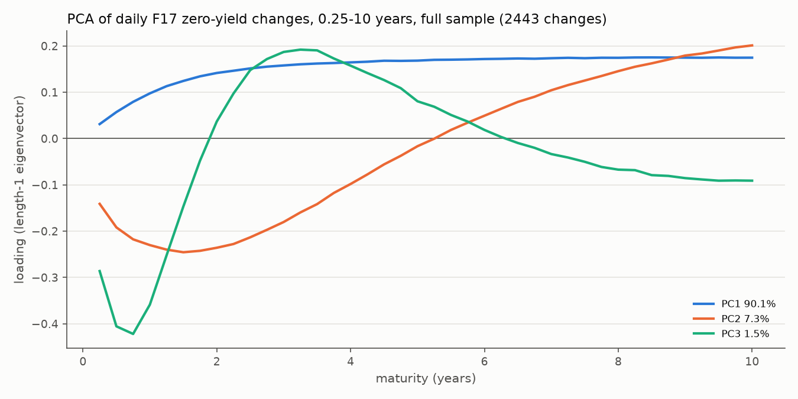
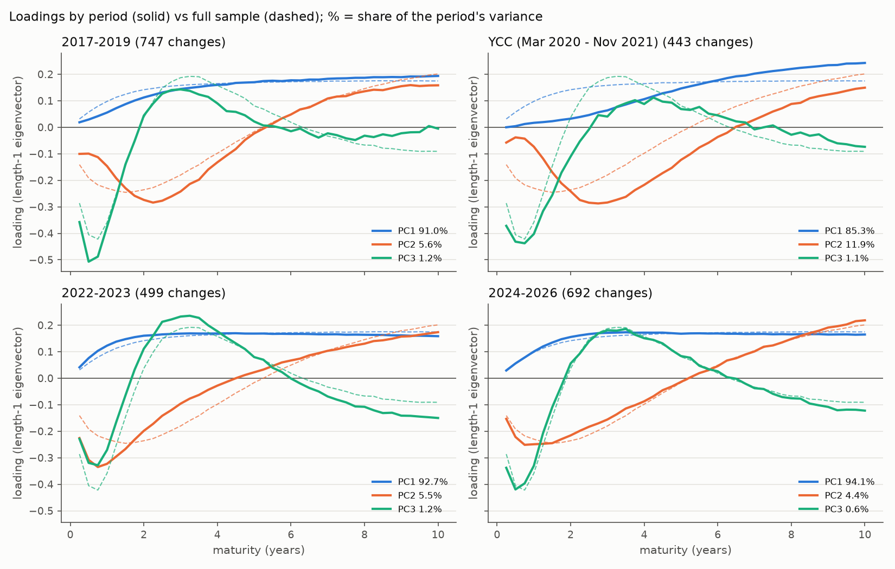

# M3 - factor structure report

Generated by `src/m3_factors.py` from `data/raw/rba_f17_zero_coupon_yields.csv` (`data.load_f17`, `data.daily_changes_bp`): daily changes in bp of F17 zero-coupon yields at 0.25-10 years (40 series; the 0-year point is the cash rate). PCA on the covariance matrix; loadings are eigenvectors of length 1.

## Answer

- **Shares.** PC1-3 explain 98.9% of the variance of daily changes (PC1 / PC2 / PC3 90.1 / 7.3 / 1.5%), and 97.7% (2017-2019) to 99.4% (2022-2023) by period. Most of the rest is rounding of yields to whole bp (0.3-1.8% of variance, against 0.6-2.3% left; section 1), so the period ranking says little about factor structure, and a fitted smooth curve flatters every share.
- **Shapes.** PC1 is level (+0.03 at 0.25y, +0.16 at 4y, +0.17 at 10y). PC2 is slope (lowest at 1.5y, -0.25; +0.20 at 10y; crossing zero between 5.25 and 5.5y). PC3 is curvature of the money-market end against the belly (lowest at 0.75y, highest at 3.25y, changing sign between 1.75 and 2y and between 6.25 and 6.5y).
- **Stability.** Against the rest of the sample, PC1 keeps its shape outside YCC (cosine >= 0.987); PC2 / PC3 vary more (2022-2023: 0.86 / 0.87). Under YCC (vs rest 0.90 / 0.73 / 0.81) PC1 sits on the long end (0.25y +0.00, 10y +0.24) and PC2 has 11.9% of variance (4.4-5.6% elsewhere), but only 5.4% in the regime before the late-Oct 2021 break: the extra comes mostly from 2-19 Mar 2020 and the break, not from the months the target held.
- **PC3 is weakly identified.** Its eigenvalue is 2.7x PC4's in 2017-2019 and 2.2x under YCC (5.6x full sample). Kept, the suspect days form a short-end factor that becomes PC3 in 2017-2019 and pushes curvature to PC4 (cosine 0.90 with the main PC3): a reason to drop them. For M4, a PC's sign does not change hedge weights; PC3's identity and how well 2/5/10y pin it down do (condition number 74 in 2017-2019, 3.9 full sample).

## 1. Variance explained

| period | first change | last change | n changes | total variance (bp^2/day) | PC1 % | PC2 % | PC3 % | PC4 % | PC1-3 cum % | rounding floor % |
|---|---|---|---|---|---|---|---|---|---|---|
| Full sample | 2017-01-04 | 2026-09-30 | 2443 | 917 | 90.1 | 7.3 | 1.5 | 0.27 | 98.9 | 0.73 |
| 2017-2019 | 2017-01-04 | 2019-12-31 | 747 | 376 | 91.0 | 5.6 | 1.2 | 0.44 | 97.7 | 1.77 |
| YCC (Mar 2020 - Nov 2021) | 2020-03-02 | 2021-11-30 | 443 | 601 | 85.3 | 11.9 | 1.1 | 0.52 | 98.3 | 1.11 |
| 2022-2023 | 2022-01-04 | 2023-12-29 | 499 | 2094 | 92.7 | 5.5 | 1.2 | 0.24 | 99.4 | 0.32 |
| 2024-2026 | 2024-01-02 | 2026-09-30 | 692 | 878 | 94.1 | 4.4 | 0.6 | 0.15 | 99.1 | 0.76 |

Total variance = the sum of the 40 maturities' daily variances (2022-2023 most volatile, 2017-2019 least). 'rounding floor %' = the rounding noise as a share of it; it is most of the 100 - 'PC1-3 cum %' left over, so a calm period shows a lower PC1-3 share for that reason alone.

## 2. Loadings, full sample

| period | PC | 0.25y | 0.5y | 1y | 2y | 3y | 5y | 7y | 10y |
|---|---|---|---|---|---|---|---|---|---|
| Full sample | PC1 | +0.03 | +0.06 | +0.10 | +0.14 | +0.16 | +0.17 | +0.17 | +0.17 |
| Full sample | PC2 | -0.14 | -0.19 | -0.23 | -0.24 | -0.18 | -0.02 | +0.10 | +0.20 |
| Full sample | PC3 | -0.29 | -0.41 | -0.36 | +0.04 | +0.19 | +0.08 | -0.03 | -0.09 |

PC1 is small at 0.25y, which fits a money-market end tied to the cash rate between decisions. PC3 moves the money-market end against the belly, so it is not the textbook 2-5-10 butterfly.

## 3. Loadings by period and stability

| period | PC | 0.25y | 0.5y | 1y | 2y | 3y | 5y | 7y | 10y |
|---|---|---|---|---|---|---|---|---|---|
| 2017-2019 | PC1 | +0.02 | +0.03 | +0.06 | +0.11 | +0.14 | +0.17 | +0.18 | +0.19 |
| 2017-2019 | PC2 | -0.10 | -0.10 | -0.15 | -0.27 | -0.24 | -0.02 | +0.11 | +0.16 |
| 2017-2019 | PC3 | -0.36 | -0.51 | -0.38 | +0.04 | +0.14 | +0.02 | -0.02 | -0.01 |
| YCC (Mar 2020 - Nov 2021) | PC1 | +0.00 | +0.00 | +0.02 | +0.03 | +0.06 | +0.15 | +0.20 | +0.24 |
| YCC (Mar 2020 - Nov 2021) | PC2 | -0.06 | -0.04 | -0.07 | -0.24 | -0.28 | -0.12 | +0.03 | +0.15 |
| YCC (Mar 2020 - Nov 2021) | PC3 | -0.37 | -0.43 | -0.40 | -0.11 | +0.04 | +0.07 | -0.01 | -0.07 |
| 2022-2023 | PC1 | +0.04 | +0.08 | +0.12 | +0.16 | +0.17 | +0.17 | +0.17 | +0.16 |
| 2022-2023 | PC2 | -0.23 | -0.31 | -0.32 | -0.20 | -0.10 | +0.02 | +0.10 | +0.17 |
| 2022-2023 | PC3 | -0.23 | -0.32 | -0.27 | +0.11 | +0.23 | +0.08 | -0.07 | -0.15 |
| 2024-2026 | PC1 | +0.03 | +0.06 | +0.10 | +0.16 | +0.17 | +0.17 | +0.17 | +0.16 |
| 2024-2026 | PC2 | -0.15 | -0.22 | -0.25 | -0.22 | -0.16 | -0.01 | +0.10 | +0.22 |
| 2024-2026 | PC3 | -0.34 | -0.42 | -0.33 | +0.06 | +0.18 | +0.08 | -0.04 | -0.12 |

Cosines after sign alignment with the full sample ('cos PCk') and with a PCA on all changes outside the period ('vs rest'). Read 'vs rest': 'cos PCk' is inflated for a period with a large 'weight in full %'. For scale, a flat vector has cosine 0.98 with full-sample PC1 and a straight line 0.96 with PC2, so the 0.9s show the same broad shape, not the same factor in detail.

| period | weight in full % | cos PC1 | cos PC2 | cos PC3 | sign flipped | best match | cos PC1 vs rest | cos PC2 vs rest | cos PC3 vs rest |
|---|---|---|---|---|---|---|---|---|---|
| 2017-2019 | 12.6 | 0.993 | 0.967 | 0.947 | none | PC1 PC2 PC3 | 0.991 | 0.962 | 0.939 |
| YCC (Mar 2020 - Nov 2021) | 11.9 | 0.919 | 0.829 | 0.896 | none | PC1 PC2 PC3 | 0.902 | 0.727 | 0.807 |
| 2022-2023 | 46.8 | 0.997 | 0.944 | 0.947 | none | PC1 PC2 PC3 | 0.987 | 0.860 | 0.872 |
| 2024-2026 | 27.1 | 0.999 | 0.995 | 0.993 | none | PC1 PC2 PC3 | 0.997 | 0.993 | 0.991 |

## 4. PC3 separation and the hedge maturities (for M4)

| period | PC3/PC4 eigenvalue ratio | PC3 at 2y | PC3 at 5y | PC3 at 10y | cond (2/5/10y) |
|---|---|---|---|---|---|
| Full sample | 5.59 | +0.037 | +0.081 | -0.091 | 3.9 |
| 2017-2019 | 2.68 | +0.044 | +0.022 | -0.005 | 74.4 |
| YCC (Mar 2020 - Nov 2021) | 2.17 | -0.110 | +0.069 | -0.074 | 2.3 |
| 2022-2023 | 4.93 | +0.111 | +0.080 | -0.150 | 4.0 |
| 2024-2026 | 4.03 | +0.056 | +0.084 | -0.122 | 4.1 |

A PC3/PC4 ratio near 1 means the two can rotate or swap in a shorter window. 'cond' is the condition number of PC1-3 at 2/5/10y, the system M4's H3 hedge solves: 74 in 2017-2019 means large, offsetting H3 weights. M4 should log, per window, PC3's best match (including PC4), this ratio and cond.

## 5. Robustness

Against the main run in the same period (YCC dates rows: the main YCC period). Correlation-matrix loadings are put in bp units first (loading x the maturity's sd).

| variant | period | n changes | PC1 % | PC2 % | PC3 % | cos PC1 | cos PC2 | cos PC3 | sign flipped | best match | main PC3 found as | its cos |
|---|---|---|---|---|---|---|---|---|---|---|---|---|
| Keep suspect days | Full sample | 2447 | 89.9 | 7.3 | 1.5 | 1.000 | 1.000 | 1.000 | none | PC1 PC2 PC3 | PC3 | 1.000 |
| Keep suspect days | 2017-2019 | 751 | 89.7 | 5.4 | 2.0 | 1.000 | 0.998 | 0.439 | PC3 | PC1 PC2 PC5 | PC4 | 0.898 |
| Correlation matrix | Full sample | 2443 | 86.5 | 9.3 | 2.6 | 1.000 | 0.970 | 0.837 | none | PC1 PC2 PC3 | PC3 | 0.837 |
| Correlation matrix | 2017-2019 | 747 | 84.0 | 8.6 | 3.9 | 1.000 | 0.893 | 0.619 | none | PC1 PC2 PC2 | PC3 | 0.619 |
| Correlation matrix | YCC (Mar 2020 - Nov 2021) | 443 | 67.3 | 21.4 | 7.1 | 0.995 | 0.802 | 0.758 | none | PC1 PC2 PC3 | PC3 | 0.758 |
| Correlation matrix | 2022-2023 | 499 | 90.3 | 7.4 | 1.4 | 1.000 | 0.992 | 0.927 | none | PC1 PC2 PC3 | PC3 | 0.927 |
| Correlation matrix | 2024-2026 | 692 | 90.7 | 6.8 | 1.3 | 1.000 | 0.975 | 0.715 | none | PC1 PC2 PC3 | PC4 | 0.728 |
| 0.5-10 years | Full sample | 2443 | 90.4 | 7.2 | 1.4 | 1.000 | 1.000 | 0.998 | none | PC1 PC2 PC3 | PC3 | 0.998 |
| 0.5-10 years | 2017-2019 | 747 | 91.3 | 5.5 | 1.1 | 1.000 | 1.000 | 0.998 | none | PC1 PC2 PC3 | PC3 | 0.998 |
| 0.5-10 years | YCC (Mar 2020 - Nov 2021) | 443 | 85.6 | 11.9 | 1.0 | 1.000 | 1.000 | 0.996 | none | PC1 PC2 PC3 | PC3 | 0.996 |
| 0.5-10 years | 2022-2023 | 499 | 93.1 | 5.2 | 1.1 | 1.000 | 1.000 | 0.997 | none | PC1 PC2 PC3 | PC3 | 0.997 |
| 0.5-10 years | 2024-2026 | 692 | 94.3 | 4.4 | 0.5 | 1.000 | 1.000 | 0.997 | none | PC1 PC2 PC3 | PC3 | 0.997 |
| YCC dates | regime closes (20 Mar 2020 - 1 Nov 2021) | 408 | 88.1 | 9.5 | 0.7 | 1.000 | 0.999 | 0.775 | none | PC1 PC2 PC3 | PC3 | 0.775 |
| YCC dates | regime before the break (20 Mar 2020 - 26 Oct 2021) | 404 | 92.4 | 5.4 | 0.5 | 0.996 | 0.989 | 0.508 | none | PC1 PC2 PC4 | PC4 | 0.781 |

- Keep suspect days (only periods that hold them): in 2017-2019 the artefact becomes PC3 (0.25y +0.73, 0.5y +0.49; best match 'PC1 PC2 PC5') and curvature moves to PC4 (0.90).
- Correlation matrix: PC1 explains less in every period (YCC 67.3% vs 85.3%). Under YCC the 0.25y change is 0 bp on 248 of 443 days and +/-1 bp on 164, so standardising scales rounding ticks up to unit variance. In bp units PC1 keeps its shape (>= 0.995); PC2 (0.80-0.99) and PC3 (0.62-0.93) change, and PC3's identity moves in 2017-2019, 2024-2026.
- 0.5-10 years: lowest cosine 0.996.
- YCC dates: regime closes 88.1 / 9.5 / 0.7% (main 85.3 / 11.9 / 1.1%), PC3 cosine 0.77; before the break 92.4 / 5.4 / 0.5%, and the main PC3 is found as PC4 (0.78): without the transitions PC3 and PC4 swap.

## 6. Limitations

- **Fitted smooth curve.** F17 is fitted, not 40 traded bonds, so neighbouring maturities move together by construction and 3 factors explain more than they would for bond yields. M4's out-of-sample hedge test is the check that matters.
- **YCC.** The RBA held the 3-year bond yield and the cash rate near zero, so the factors there describe a constrained curve; the fitted curve did not follow the target bond closely (M1 section 10).
- **Gaps.** A change after a weekend or holiday covers several calendar days, including the missing 20-21 Jul 2026 (M1 section 4). Not adjusted.
- **Stationarity.** Total variance differs by a factor of 5.6 between periods, so a full-sample PCA averages regimes; M4 re-estimates on a trailing window.
- **Suspect days** are a judgement (M1 section 5) made with hindsight (the curve came back the next day); the robustness rows show what keeping them does.

## Files

`outputs/m3/`: this report, `loadings_full_sample.png`, `loadings_by_period.png`, `loadings.csv` (PC1-3 at all 40 maturities), `variance_explained.csv`, `stability.csv`, `separation.csv`, `robustness.csv` (CSVs unrounded).
