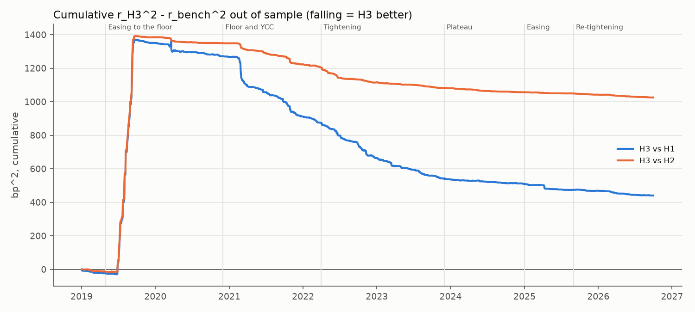
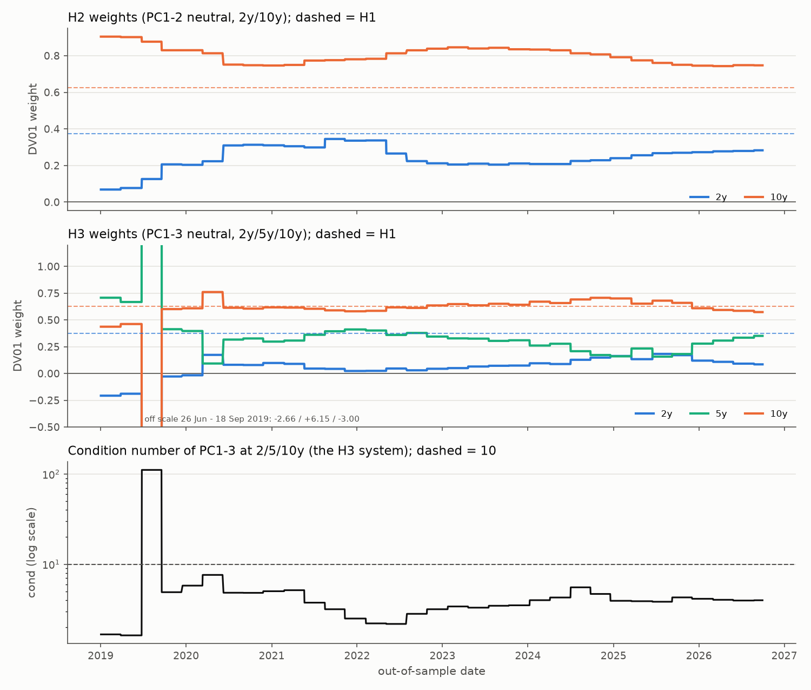

# M4 - hedging test report

Generated by `src/m4_hedging.py` on 24 Oct 2026 from F17 zero-coupon yields (`data.load_f17`, `data.daily_changes_bp`). Position: long a 7-year zero, 1 unit of DV01; residual r = dy7 - sum_i w_i dy_i in bp of DV01 (weights in DV01 units; hedges in section 1). PCA (`m3_factors.pca_loadings`, covariance, 0.25-10y) on the trailing 500 changes up to and including t, weights fixed for the next 60 F17 changes, then t moves 60 changes on.

## Answer

Does a 3-factor hedge (H3) leave less risk than duration (H1)?

- **No, not over the whole sample with the planned PCA.** Out of sample (1,943 days, 02 Jan 2019 - 30 Sep 2026, 33 blocks of up to 60 days) the unhedged 7-year position moves 5.46 bp/day; duration (H1) leaves 0.93, level + slope (H2) 0.74 and level + slope + curvature (H3) 1.04. H3 does not beat H1 (t = +0.77, p = 0.441 at Newey-West lag 7; p = 0.762 block-clustered) and does not beat H2 (t = +1.85, p = 0.064; p = 0.476 block-clustered).
- **One block decides it.** For 26 Jun 2019 - 18 Sep 2019, cond(2/5/10y) was 111 at t (7.6 or less in every other block). The window's PC3 had 77% of its squared loading at 1y or shorter and loaded +0.06 / +0.02 / -0.01 at 2/5/10y, so H3's weights were -2.66 / +6.15 / -3.00 (total DV01 0.49). H3 left 4.93 bp/day there, more than no hedge (3.96); rounding noise amplified by those weights could be 38% of that variance.
- **Elsewhere H3 is usually the best hedge** (a split made after seeing the results). Its mean squared residual is below H1's in 32 of 33 blocks and below H2's in 32. On the other 32 blocks it leaves 0.60 bp/day against 0.93 (H1) and 0.75 (H2): t vs H1 = -7.0 at lag 7, -5.3 block-clustered.
- **The verdict is fragile.** Keeping the two suspect F17 days in estimation fixes that block (cond 9.7, H3 0.62 vs H1 0.79), but then 8 blocks (19 Sep 2019 - 09 Nov 2021) have cond > 10 and H3's sd is 1.70. With the PCA on 1-10y instead of 0.25-10y (section 5, rows 6-7, chosen after seeing the results) cond stays at or below 2.9 and H3 leaves 0.59 bp/day (block-clustered t = -5.4 vs H1, -5.1 vs H2; 0.68 with the suspect days). So the answer turns on letting the 0.25-0.75y end shape PC3.
- **H2 is the steady hedge:** 0.74 bp/day overall, weights within 0.07-0.34 (2y) and 0.74-0.90 (10y) in every block.

## 1. Overall, out of sample

| hedge | what | n days | mean (bp/day) | sd (bp/day) | variance removed % | rounding floor sd |
|---|---|---|---|---|---|---|
| H0 | unhedged | 1943 | +0.152 | 5.46 | 0.0 | 0.41 |
| H1 | duration: 0.375 x 2y + 0.625 x 10y | 1943 | -0.007 | 0.93 | 97.1 | 0.51 |
| H2 | PC1-2 neutral, 2y/10y | 1943 | -0.025 | 0.74 | 98.1 | 0.53 |
| H3 | PC1-3 neutral, 2y/5y/10y | 1943 | -0.016 | 1.04 | 96.4 | 0.73 |

Means are at most 0.025 bp/day for H1-H3, so sd and root mean square barely differ. 'rounding floor sd' = the sd r would have from F17's rounding to whole bp alone: it could account for 30% (H1), 51% (H2), 49% (H3) of the residual variance.

## 2. By episode

| episode | months | n days | n blocks | sd H0 | sd H1 | sd H2 | sd H3 | % removed H1 | % removed H2 | % removed H3 | floor H3 |
|---|---|---|---|---|---|---|---|---|---|---|---|
| Steady | 2017-01 to 2019-04 | 79 | 2 | 3.70 | 0.79 | 0.70 | 0.57 | 95.5 | 96.4 | 97.7 | 0.54 |
| Easing to the floor | 2019-05 to 2020-11 | 400 | 8 | 4.32 | 0.87 | 0.76 | 2.00 | 96.0 | 96.9 | 78.6 | 1.26 |
| Floor and YCC | 2020-12 to 2022-03 | 335 | 6 | 4.89 | 1.26 | 0.92 | 0.64 | 93.4 | 96.5 | 98.3 | 0.50 |
| Tightening | 2022-04 to 2023-11 | 418 | 8 | 7.60 | 1.06 | 0.78 | 0.57 | 98.1 | 98.9 | 99.4 | 0.50 |
| Plateau | 2023-12 to 2024-12 | 271 | 6 | 5.26 | 0.67 | 0.65 | 0.58 | 98.4 | 98.5 | 98.8 | 0.51 |
| Easing | 2025-01 to 2025-08 | 167 | 3 | 4.71 | 0.69 | 0.56 | 0.52 | 97.8 | 98.6 | 98.8 | 0.50 |
| Re-tightening | 2025-09 to 2026-09 | 273 | 6 | 4.64 | 0.65 | 0.62 | 0.54 | 98.1 | 98.2 | 98.6 | 0.50 |

On all blocks H3 has the lowest sd of H1-H3 in 6 of 7 episodes (not in Easing to the floor); without block 2 in 7 of 7 (Easing to the floor: H3 0.68, H2 0.77, H1 0.88). Where H3 is lowest, rounding alone could account for 61-94% of its variance; the rest has an sd of 0.13-0.40 bp/day (sqrt(sd^2 - floor^2)). Steady holds only 79 days.

## 3. Paired tests on squared residuals

| test | sample | n | se type | mean d | se | t | p |
|---|---|---|---|---|---|---|---|
| H3 vs H1 | all | 1943 | NW lag 7 | +0.227 | 0.294 | +0.77 | 0.441 |
| H3 vs H1 | all | 1943 | cluster, 33 blocks | +0.227 | 0.741 | +0.31 | 0.762 |
| H3 vs H1 | Steady | 79 | NW lag 3 | -0.295 | 0.125 | -2.36 | 0.021 |
| H3 vs H1 | Easing to the floor | 400 | NW lag 5 | +3.237 | 1.192 | +2.72 | 0.007 |
| H3 vs H1 | Floor and YCC | 335 | NW lag 5 | -1.187 | 0.311 | -3.82 | <0.001 |
| H3 vs H1 | Tightening | 418 | NW lag 5 | -0.800 | 0.108 | -7.42 | <0.001 |
| H3 vs H1 | Plateau | 271 | NW lag 4 | -0.113 | 0.033 | -3.39 | <0.001 |
| H3 vs H1 | Easing | 167 | NW lag 4 | -0.207 | 0.107 | -1.94 | 0.054 |
| H3 vs H1 | Re-tightening | 273 | NW lag 5 | -0.123 | 0.028 | -4.33 | <0.001 |
| H3 vs H2 | all | 1943 | NW lag 7 | +0.528 | 0.285 | +1.85 | 0.064 |
| H3 vs H2 | all | 1943 | cluster, 33 blocks | +0.528 | 0.731 | +0.72 | 0.476 |
| H3 vs H2 | Steady | 79 | NW lag 3 | -0.171 | 0.086 | -1.99 | 0.051 |
| H3 vs H2 | Easing to the floor | 400 | NW lag 5 | +3.407 | 1.186 | +2.87 | 0.004 |
| H3 vs H2 | Floor and YCC | 335 | NW lag 5 | -0.433 | 0.095 | -4.56 | <0.001 |
| H3 vs H2 | Tightening | 418 | NW lag 5 | -0.293 | 0.054 | -5.44 | <0.001 |
| H3 vs H2 | Plateau | 271 | NW lag 4 | -0.093 | 0.017 | -5.48 | <0.001 |
| H3 vs H2 | Easing | 167 | NW lag 4 | -0.045 | 0.016 | -2.78 | 0.006 |
| H3 vs H2 | Re-tightening | 273 | NW lag 5 | -0.088 | 0.015 | -5.91 | <0.001 |

Negative t = H3 better. Lag 7 is too short for the full sample: the autocorrelation of d (H3 vs H1) at lags 1 / 5 / 10 is 0.38 / 0.19 / 0.25 over all blocks and 0.19 / 0.10 / 0.05 without block 2, so the persistence is mostly that block's shift in mean. All days of a block share one set of weights, so the block-clustered rows (p from t(32)) are the conservative check; neither full-sample verdict changes. H3's mean squared residual is smaller in 32 of 33 blocks against H1 and 32 against H2: in the chart the sums turn on one 2019 jump. Episode p-values are optimistic: an episode spans only 2-8 blocks (too few to cluster), and they are not adjusted for the 14 tests (Bonferroni would need p < 0.0036).

## 4. Hedge weights over time and the 2019 block

Blocks with cond > 10 or whose PC3 best matches another full-sample PC ('H3 total' = H3's DV01 per unit of the position's; 'block sd' = residual sd in that block):

| field | block 0 | block 1 | block 2 |
|---|---|---|---|
| eval first | 02 Jan 2019 | 28 Mar 2019 | 26 Jun 2019 |
| eval last | 27 Mar 2019 | 25 Jun 2019 | 18 Sep 2019 |
| cond (2/5/10y) | 1.7 | 1.6 | 111.3 |
| PC3/PC4 eigenvalue ratio | 1.60 | 1.35 | 2.56 |
| PC3 best match | PC4 | PC4 | PC3 |
| its cos | 0.71 | 0.75 | 0.94 |
| PC3 share <= 1y | 1% | 3% | 77% |
| PC3 at 2y | -0.202 | -0.208 | +0.060 |
| PC3 at 5y | +0.243 | +0.235 | +0.016 |
| PC3 at 7y | +0.094 | +0.077 | -0.025 |
| PC3 at 10y | -0.275 | -0.257 | -0.011 |
| H3 w2 | -0.21 | -0.19 | -2.66 |
| H3 w5 | +0.71 | +0.67 | +6.15 |
| H3 w10 | +0.44 | +0.46 | -3.00 |
| H3 total | +0.94 | +0.94 | +0.49 |
| block sd H0 | 3.58 | 3.40 | 3.96 |
| block sd H1 | 0.83 | 0.67 | 0.79 |
| block sd H2 | 0.70 | 0.66 | 0.70 |
| block sd H3 | 0.54 | 0.59 | 4.93 |

In this 0.25-10y PCA, PC3 is mostly a money-market factor: 55% of the full-sample PC3's squared loading sits at 1y or shorter, 77% in block 2, whose PC3 barely touches 2-10y (table above), so zeroing a negligible exposure took the large weights. 'PC3 best match' compares all 40 maturities, so the short end decides it and it does not show this. The 2 blocks whose PC3 is a 2-10y curvature (best match PC4, at most 3% at 1y or shorter) hedged well (block sd H3 0.54-0.59 vs H1 0.67-0.83), while other windows with a short-end PC3 (shares up to 76%) kept cond <= 7.6. PC3's identity and the conditioning cannot be separated here. Section 5, rows 8-9, splits the blocks by cond.

## 5. Suspect days, PCA range and a fallback rule

| rows | n blocks | n days | sd H0 | sd H1 | sd H2 | sd H3 | % removed H3 | t H3 vs H1 | t cl H3 vs H1 | t H3 vs H2 | t cl H3 vs H2 |
|---|---|---|---|---|---|---|---|---|---|---|---|
| 1 main: suspect days out of estimation and evaluation | 33 | 1943 | 5.46 | 0.93 | 0.74 | 1.04 | 96.4 | +0.77 | +0.31 | +1.85 | +0.72 |
| 2 evaluation keeps the suspect days | 33 | 1947 | 5.46 | 0.92 | 0.75 | 1.05 | 96.3 | +0.83 | +0.33 | +1.90 | +0.74 |
| 3 estimation and evaluation keep them | 33 | 1947 | 5.46 | 0.92 | 0.75 | 1.70 | 90.3 | +3.24 | +1.82 | +3.52 | +1.99 |
| 4 row 1, H3 -> H2 when cond > 10 | 33 | 1943 | 5.46 | 0.93 | 0.74 | 0.60 | 98.8 | -7.04 | -5.28 | -8.03 | -5.28 |
| 5 row 3, H3 -> H2 when cond > 10 | 33 | 1947 | 5.46 | 0.92 | 0.75 | 0.77 | 98.0 | -3.26 | -1.97 | +0.44 | +0.24 |
| 6 row 1, PCA on 1-10y | 33 | 1943 | 5.46 | 0.93 | 0.74 | 0.59 | 98.8 | -7.20 | -5.44 | -7.76 | -5.13 |
| 7 row 3, PCA on 1-10y | 33 | 1947 | 5.46 | 0.92 | 0.75 | 0.68 | 98.5 | -6.69 | -4.79 | -3.93 | -2.24 |
| 8 row 1, only blocks with cond <= 10 | 32 | 1883 | 5.50 | 0.93 | 0.75 | 0.60 | 98.8 | -7.00 | -5.28 | -8.06 | -5.35 |
| 9 row 1, only blocks with cond > 10 | 1 | 60 | 3.96 | 0.79 | 0.70 | 4.93 | -54.8 | +5.64 | n/a | +5.66 | n/a |

Rows 2-3 put the 4 suspect-day changes back (evaluation only; estimation and evaluation). Rows 4-5 replace H3 by H2 in blocks with cond > 10 at t. Rows 6-7 estimate the PCA on 1-10y only (max cond 2.9). Rows 8-9 split row 1 by cond at t. The threshold and the range were chosen after seeing row 1, so rows 4-9 show what such a rule would do, not a clean test of it. The fallback at other thresholds:

| rows | blocks swapped | sd H3 | t H3 vs H1 | t H3 vs H2 | t cl H3 vs H1 | t cl H3 vs H2 |
|---|---|---|---|---|---|---|
| main, cond > 5 | 6 | 0.63 | -7.57 | -7.61 | -5.54 | -4.41 |
| main, cond > 8 | 1 | 0.60 | -7.04 | -8.03 | -5.28 | -5.28 |
| main, cond > 10 | 1 | 0.60 | -7.04 | -8.03 | -5.28 | -5.28 |
| main, cond > 20 | 1 | 0.60 | -7.04 | -8.03 | -5.28 | -5.28 |
| main, cond > 50 | 1 | 0.60 | -7.04 | -8.03 | -5.28 | -5.28 |
| keep suspect days, cond > 5 | 12 | 0.68 | -6.66 | -6.51 | -5.03 | -3.58 |
| keep suspect days, cond > 8 | 10 | 0.74 | -3.89 | -0.35 | -2.43 | -0.20 |
| keep suspect days, cond > 10 | 8 | 0.77 | -3.26 | +0.44 | -1.97 | +0.24 |
| keep suspect days, cond > 20 | 6 | 0.79 | -2.48 | +0.97 | -1.59 | +0.58 |
| keep suspect days, cond > 50 | 1 | 1.43 | +2.45 | +3.03 | +1.42 | +1.74 |

In the main run any threshold between 7.6 and 111 swaps only block 2 and gives row 4. In the keep-suspect run the answer moves with the threshold, and 2 block(s) with cond <= 10 (ids 5, 12) still have a higher H3 than H2 block sd, so a gate would not catch them. No gate is used in the main test.

## 6. Limitations

- **Fitted smooth curve flatters factor hedges.** The 2, 5, 7 and 10-year points come from one smooth RBA fit, so the 7-year change is close to a fixed mix of its neighbours by construction; three points pin a smooth curve better than two, so H3 gains most. Residuals here are a lower bound.
- **Constant maturity, first-order P&L.** No ageing, carry, roll-down, funding, convexity or re-hedging cost; DV01 weights stay fixed for 60 days. The rounding floors assume independent errors.
- **One design.** One position (7y), window 500, step 60; M5 varies them. Episode bounds are judgement (M2). Changes over holiday gaps (including the missing 20-21 Jul 2026) count as one day.

Files in `outputs/m4/`: this report, the two PNGs, `residuals.csv` (main run, every evaluation day), `blocks.csv` (every block of the 4 runs) and each table above as a CSV (unrounded).
