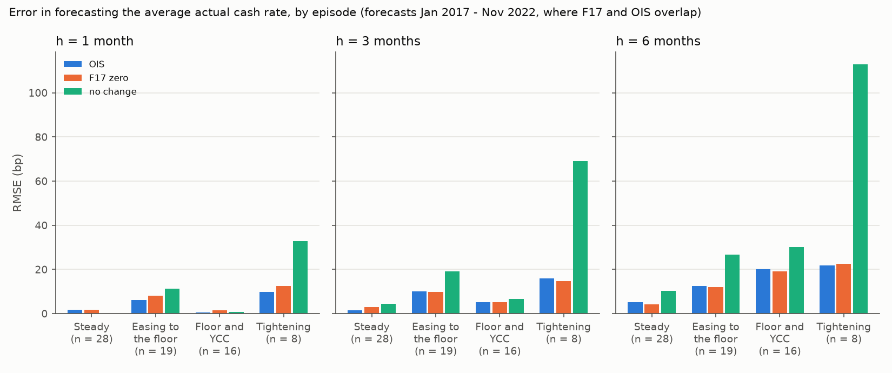
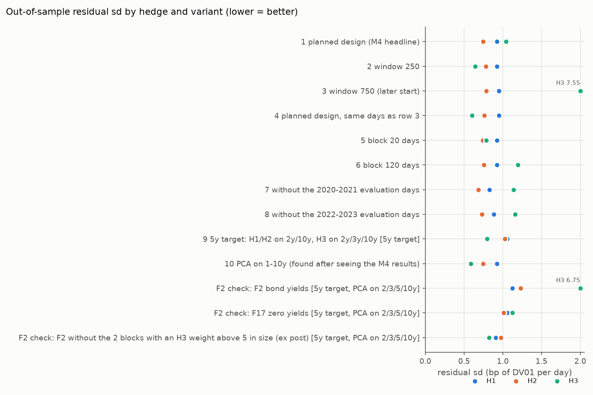

# M5 - robustness report

Generated by `src/m5_robustness.py` on 11 Nov 2026. The planned designs of M2 and M4 stay the headline; everything here is robustness. The M4 PCA on 1-10y was found after seeing the M4 results and is labelled that way. F1 (OIS: FENICS data) and F2 (licence unchecked) stay on disk: this folder holds only statistics and charts of statistics, no series.

## Answer: which results survive

- **Forecasting the target (M2).** The F17 forward has a lower RMSE than no change in all 18 M2 variants, but the Diebold-Mariano (DM) p-value is below 5% only in 'excluding Tightening', a row added after seeing the M2 results. From 2022 on the 3-month DM p is 0.097.
- **OIS (F1).** Over the 71 month-ends where F17 and F1's OIS overlap (Jan 2017 - Nov 2022; F1's OIS ends 01 Dec 2022), OIS and the F17 zero yield cannot be told apart (p = 0.187, 0.574 and 0.418 at 1, 3 and 6 months). That is expected rather than reassuring: the RBA fits the 0-1 year part of its curve to OIS (RDP 2008-09; M1 section 9), so this does not show that bond prices alone carry the same information. At 1 month OIS is more accurate on every measure (RMSE 4.8 vs 6.1 bp, MAE 1.9 vs 3.3, bias -0.1 vs +1.1).
- **F17 vs no change, to Aug 2026.** The F17 zero yield beats no change at 1, 3 and 6 months, significantly only at 1 month (DM p = 0.015, 0.066, 0.109), and sits below the realised average cash rate (section 1c).
- **Hedging (M4).** H3 still fails to beat duration (H1) in 5 of 7 planned variants, but each failure rests on one ill-conditioned block: row 5 (block 20 days), row 6 (block 120 days), row 7 (without the 2020-2021 evaluation days) and row 8 (without the 2022-2023 evaluation days) keep M4's 26 Jun 2019 - 18 Sep 2019 trouble, and row 3 (window 750) fails on a block of its own. It flips in row 2 (window 250) and row 9 (5y target), as it does in row 10 (PCA on 1-10y, found after seeing the M4 results); on row 3's days the planned design itself has H3 beating H1 (row 4, t = -4.96, p < 0.001). Level and slope (H2) beat duration in every 7-year run (block-clustered p <= 0.008), but not for the 5-year target (p = 0.623).
- **Bond yields (F2), 5-year bond.** No factor hedge is significantly better than duration (H3 vs H1 p = 0.189, H2 vs H1 p = 0.162). H3 did worse than no hedge (6.75 vs 5.29 bp/day) because of 2 blocks where the system H3 solves was ill-conditioned at t (cond 51.0 and 8.9, against 3.0 or less in the other blocks). With four maturities H3 shows no edge on F17 either (1.12 vs H1 1.06), so this check cannot test M4's 40-maturity result.

## 1. OIS benchmark (the headline addition)

Forecast dates: the last F17 business day of each month (as M2). Forecasts of the average actual cash rate over the next h months: the h-month OIS on t (on the average-rate basis), the F17 zero yield at h/12 years and no change (F1's cash rate on t). Outcome: the average of F1's cash rate over the calendar days in (t, t + h months]. Error = outcome - forecast (bp). F1's OIS columns end on 01 Dec 2022 (F1 gives no reason), so sections 1a-1b use the 71 month-ends where F17 and OIS overlap, Jan 2017 - Nov 2022: Steady, Easing to the floor, Floor and YCC and the first 8 Tightening forecasts. 'bias p' tests mean error = 0 and DM uses d = e_model^2 - e_bench^2 (negative = model better), both Newey-West with lag h; 'HLN p' is the small-sample version (M2). At h = 1 HLN uses no lags, so there it is the less cautious p.

### 1a. Over the whole OIS sample

| h | forecast | n | bias (bp) | bias p | MAE (bp) | RMSE (bp) |
|---|---|---|---|---|---|---|
| 1 | OIS | 71 | -0.1 | 0.824 | 1.9 | 4.8 |
| 1 | F17 zero | 71 | 1.1 | 0.162 | 3.3 | 6.1 |
| 1 | no change | 71 | 1.9 | 0.324 | 5.2 | 12.5 |
| 3 | OIS | 71 | 0.0 | 0.976 | 3.6 | 7.9 |
| 3 | F17 zero | 71 | 1.8 | 0.135 | 4.5 | 7.6 |
| 3 | no change | 71 | 4.2 | 0.451 | 11.6 | 25.5 |
| 6 | OIS | 71 | 0.1 | 0.964 | 7.4 | 14.0 |
| 6 | F17 zero | 71 | 0.2 | 0.938 | 7.3 | 13.6 |
| 6 | no change | 71 | 8.3 | 0.487 | 21.9 | 43.2 |

| h | test | n | mean d (bp^2) | t | p | HLN p |
|---|---|---|---|---|---|---|
| 1 | OIS vs F17 zero | 71 | -14 | -1.33 | 0.187 | 0.202 |
| 1 | OIS vs no change | 71 | -133 | -2.16 | 0.034 | 0.006 |
| 1 | F17 zero vs no change | 71 | -119 | -2.14 | 0.036 | 0.005 |
| 3 | OIS vs F17 zero | 71 | 4 | +0.56 | 0.574 | 0.589 |
| 3 | OIS vs no change | 71 | -589 | -1.65 | 0.104 | 0.165 |
| 3 | F17 zero vs no change | 71 | -593 | -1.65 | 0.104 | 0.165 |
| 6 | OIS vs F17 zero | 71 | 10 | +0.82 | 0.418 | 0.390 |
| 6 | OIS vs no change | 71 | -1672 | -1.47 | 0.145 | 0.244 |
| 6 | F17 zero vs no change | 71 | -1682 | -1.48 | 0.143 | 0.241 |

OIS and the F17 zero yield cannot be told apart (p = 0.187, 0.574 and 0.418). The RBA fits the 0-1 year part of its curve to OIS (RDP 2008-09, Appendix A; not checked for F17 after its Dec 2023 input change), so close agreement is built in. At 1 month OIS is more accurate on RMSE, MAE and bias. Both beat no change at every horizon, significantly only at 1 month (p = 0.034 for OIS, 0.036 for F17 zero). OIS has almost no bias (-0.1 to +0.1 bp); the F17 zero yield is +0.2 to +1.8 bp (lowest p 0.135).

### 1b. By episode

| h | episode | n | bias OIS | RMSE OIS | bias F17 zero | RMSE F17 zero | bias no change | RMSE no change |
|---|---|---|---|---|---|---|---|---|
| 1 | Steady | 28 | 0.5 | 1.8 | 1.2 | 1.8 | 0.0 | 0.0 |
| 1 | Easing to the floor | 19 | -1.0 | 6.3 | -2.2 | 8.1 | -5.8 | 11.4 |
| 1 | Floor and YCC | 16 | 0.2 | 0.6 | 0.0 | 1.5 | -0.2 | 0.8 |
| 1 | Tightening | 8 | -0.9 | 9.8 | 11.0 | 12.5 | 31.3 | 32.8 |
| 3 | Steady | 28 | 0.2 | 1.4 | 2.6 | 2.9 | -1.1 | 4.5 |
| 3 | Easing to the floor | 19 | -3.0 | 10.0 | -1.2 | 9.7 | -12.2 | 19.0 |
| 3 | Floor and YCC | 16 | 1.6 | 5.2 | 2.8 | 5.1 | 2.3 | 6.7 |
| 3 | Tightening | 8 | 2.6 | 16.0 | 4.1 | 14.6 | 65.1 | 69.0 |
| 6 | Steady | 28 | -1.7 | 5.1 | -0.6 | 4.3 | -3.7 | 10.3 |
| 6 | Easing to the floor | 19 | -6.4 | 12.5 | -5.2 | 12.0 | -19.9 | 26.7 |
| 6 | Floor and YCC | 16 | 8.4 | 20.0 | 7.4 | 19.2 | 13.5 | 30.0 |
| 6 | Tightening | 8 | 5.6 | 21.8 | 1.5 | 22.5 | 106.6 | 112.8 |

The forecasts differ most in Tightening at 1 month (F17 zero bias +11.0 bp, OIS -0.9, 8 forecasts). F17 publishes no 1-month point, and its fitted curve is smooth and pinned at the overnight rate on t, so neither the curve nor an interpolation of it shows a hike priced for the first days of the month. In Steady the target never moved, so no change is perfect at 1 month.

### 1c. F17 zero yield vs no change, to the last full window inside F1

| h | forecast | n | bias (bp) | bias p | MAE (bp) | RMSE (bp) |
|---|---|---|---|---|---|---|
| 1 | F17 zero | 116 | 1.7 | 0.006 | 3.6 | 6.2 |
| 1 | no change | 116 | 2.2 | 0.089 | 4.8 | 11.1 |
| 3 | F17 zero | 114 | 3.1 | 0.002 | 5.6 | 8.7 |
| 3 | no change | 114 | 4.7 | 0.209 | 11.2 | 22.4 |
| 6 | F17 zero | 111 | 3.5 | 0.147 | 9.6 | 15.0 |
| 6 | no change | 111 | 8.5 | 0.312 | 21.1 | 38.0 |

| h | test | n | mean d (bp^2) | t | p | HLN p |
|---|---|---|---|---|---|---|
| 1 | F17 zero vs no change | 116 | -86 | -2.46 | 0.015 | 0.001 |
| 3 | F17 zero vs no change | 114 | -426 | -1.86 | 0.066 | 0.111 |
| 6 | F17 zero vs no change | 111 | -1216 | -1.62 | 0.109 | 0.189 |

Without OIS the sample runs to Aug 2026 (h = 1). The F17 zero yield still beats no change and sits below the realised average: +1.7 bp at h = 1 (p = 0.006); +3.1 bp at h = 3 (p = 0.002); +3.5 bp at h = 6 (p = 0.147). Most of that bias comes from Easing (+8.6 bp at 3 months) and Re-tightening (+8.0 bp at 3 months), both after F17's Dec 2023 input change; Newey-West lag h is a floor and the bias test has no small-sample version, so read these p-values as rough. By episode: `f17_vs_no_change_episodes.csv`.

## 2. M2 checks

Forward vs no change for the target in effect (M2's outcome); bias and RMSE in bp. Rows built with M2's own functions; '2022 onwards' keeps forecasts made from Jan 2022.

| variant | h | n | fwd bias | fwd RMSE | gap-adj RMSE | no-chg RMSE | DM t | DM p | HLN p | Fama b | p b=1 |
|---|---|---|---|---|---|---|---|---|---|---|---|
| main (month-end, t + h months) | 3 | 114 | 4.6 | 16.0 | 15.7 | 36.3 | -1.76 | 0.081 | 0.131 | 0.87 | 0.082 |
| outcome date t + days | 3 | 114 | 4.4 | 15.9 | 15.6 | 36.2 | -1.76 | 0.081 | 0.132 | 0.87 | 0.081 |
| mid-month forecast dates | 3 | 114 | 6.2 | 17.7 | 17.1 | 36.2 | -1.76 | 0.081 | 0.131 | 0.96 | 0.560 |
| excluding Floor and YCC | 3 | 98 | 4.2 | 16.4 | 16.3 | 38.3 | -1.76 | 0.081 | 0.132 | 0.87 | 0.056 |
| excluding Tightening (added after seeing the M2 results) | 3 | 94 | 5.9 | 13.7 | 13.1 | 20.2 | -2.47 | 0.016 | 0.030 | 0.92 | 0.597 |
| 2022 onwards (new in M5) | 3 | 54 | 6.6 | 20.8 | 20.8 | 49.8 | -1.69 | 0.097 | 0.161 | 0.82 | 0.022 |
| main (month-end, t + h months) | 6 | 111 | 7.4 | 30.9 | 30.4 | 66.6 | -1.59 | 0.114 | 0.203 | 1.01 | 0.914 |
| outcome date t + days | 6 | 111 | 7.4 | 30.9 | 30.4 | 66.6 | -1.59 | 0.114 | 0.203 | 1.01 | 0.914 |
| mid-month forecast dates | 6 | 111 | 8.7 | 35.0 | 34.3 | 66.5 | -1.58 | 0.117 | 0.208 | 1.01 | 0.946 |
| excluding Floor and YCC | 6 | 95 | 4.4 | 26.0 | 25.9 | 64.0 | -1.59 | 0.116 | 0.197 | 0.95 | 0.506 |
| excluding Tightening (added after seeing the M2 results) | 6 | 91 | 7.7 | 31.6 | 31.2 | 45.9 | -1.81 | 0.074 | 0.099 | 1.17 | 0.585 |
| 2022 onwards (new in M5) | 6 | 51 | 22.1 | 42.0 | 41.1 | 93.3 | -1.54 | 0.129 | 0.249 | 0.92 | 0.331 |
| main (month-end, t + h months) | 12 | 105 | 25.3 | 81.8 | 79.9 | 117.8 | -1.18 | 0.242 | 0.343 | 1.17 | 0.360 |
| outcome date t + days | 12 | 105 | 25.3 | 81.8 | 79.9 | 117.8 | -1.18 | 0.242 | 0.343 | 1.17 | 0.360 |
| mid-month forecast dates | 12 | 105 | 24.3 | 84.4 | 82.4 | 117.4 | -1.14 | 0.257 | 0.353 | 1.13 | 0.471 |
| excluding Floor and YCC | 12 | 89 | 7.9 | 61.3 | 60.4 | 95.3 | -1.08 | 0.283 | 0.359 | 1.00 | 0.982 |
| excluding Tightening (added after seeing the M2 results) | 12 | 85 | 16.7 | 83.8 | 82.1 | 99.8 | -1.01 | 0.316 | 0.383 | 1.14 | 0.777 |
| 2022 onwards (new in M5) | 12 | 45 | 64.3 | 86.6 | 84.6 | 148.7 | -1.12 | 0.267 | 0.451 | 1.10 | 0.249 |

The forward's RMSE is below no change in 18 of 18 rows; DM p is below 5% only for excluding Tightening (added after seeing the M2 results) at h = 3. From 2022 on the 3-month DM p is 0.097 and the Fama slope b = 0.82 (p for b = 1: 0.022); the 6-month forward bias is +22.1 bp.

## 3. M4 checks

H0-H3 rerun with `m4.rolling_hedges`, one change at a time; suspect days out of estimation and evaluation as in M4. t and p are block-clustered (negative t = the first hedge better); 'H3 < H1 blocks' counts blocks where H3's mean squared residual is lower; 'max abs H3 w' is the largest H3 weight in any block. Row 4 is a comparator (the planned design on row 3's days), not a variant.

| rows | n blocks | n days | sd H0 | sd H1 | sd H2 | sd H3 | t cl H3 vs H1 | p cl H3 vs H1 | t cl H3 vs H2 | p cl H3 vs H2 | t cl H2 vs H1 | p cl H2 vs H1 | H3 < H1 blocks | max abs H3 w |
|---|---|---|---|---|---|---|---|---|---|---|---|---|---|---|
| 1 planned design (M4 headline) | 33 | 1943 | 5.46 | 0.93 | 0.74 | 1.04 | +0.31 | 0.762 | +0.72 | 0.476 | -4.44 | <0.001 | 32 | 6.15 |
| 2 window 250 | 33 | 1943 | 5.46 | 0.93 | 0.78 | 0.65 | -5.38 | <0.001 | -2.40 | 0.022 | -2.92 | 0.006 | 30 | 0.89 |
| 3 window 750 (later start) | 28 | 1647 | 5.66 | 0.95 | 0.79 | 7.55 | +0.99 | 0.331 | +1.00 | 0.328 | -2.86 | 0.008 | 27 | 15.07 |
| 4 planned design, same days as row 3 | 28 | 1647 | 5.66 | 0.95 | 0.76 | 0.60 | -4.96 | <0.001 | -5.05 | <0.001 | -4.10 | <0.001 | 28 | 0.76 |
| 5 block 20 days | 98 | 1943 | 5.46 | 0.93 | 0.74 | 0.79 | -1.08 | 0.282 | +0.36 | 0.719 | -5.02 | <0.001 | 90 | 6.15 |
| 6 block 120 days | 17 | 1943 | 5.46 | 0.93 | 0.75 | 1.20 | +0.52 | 0.614 | +0.78 | 0.446 | -3.56 | 0.003 | 16 | 6.15 |
| 7 without the 2020-2021 evaluation days | 26 | 1438 | 5.74 | 0.83 | 0.68 | 1.14 | +0.62 | 0.542 | +0.84 | 0.409 | -4.16 | <0.001 | 24 | 6.15 |
| 8 without the 2022-2023 evaluation days | 26 | 1444 | 4.60 | 0.88 | 0.73 | 1.16 | +0.57 | 0.574 | +0.82 | 0.417 | -2.89 | 0.008 | 25 | 6.15 |
| 9 5y target: H1/H2 on 2y/10y, H3 on 2y/3y/10y | 33 | 1943 | 5.26 | 1.06 | 1.03 | 0.80 | -3.16 | 0.003 | -2.36 | 0.024 | -0.50 | 0.623 | 27 | 2.28 |
| 10 PCA on 1-10y (found after seeing the M4 results) | 33 | 1943 | 5.46 | 0.93 | 0.74 | 0.59 | -5.44 | <0.001 | -5.13 | <0.001 | -4.48 | <0.001 | 33 | 0.71 |

Row 1 reproduces M4 (sd 5.46 / 0.93 / 0.74 / 1.04). H3 beats H1 at 5% in row 2 (window 250), row 9 (5y target) and row 10 (PCA on 1-10y, found after seeing the M4 results), and in the comparator row 4. In every section-3 run H3 has the smaller mean squared residual in most blocks (82%-100%). Pattern found after seeing the results (7-year runs only): every losing run has a block with an H3 weight of 6.15 or more in size, and no winning run exceeds 0.89. It describes these runs; it is not a rule. The worst H3 block of each run:

| rows | eval first | eval last | cond (2/5/10y) | cond (H3 legs) | max abs H3 w | block sd H1 | block sd H2 | block sd H3 |
|---|---|---|---|---|---|---|---|---|
| 1 planned design (M4 headline) | 26 Jun 2019 | 18 Sep 2019 | 111.3 | nan | 6.15 | 0.79 | 0.70 | 4.93 |
| 2 window 250 | 12 Mar 2020 | 05 Jun 2020 | 10.2 | nan | 0.85 | 1.37 | 1.24 | 1.39 |
| 3 window 750 (later start) | 12 Mar 2020 | 05 Jun 2020 | 193.8 | nan | 15.07 | 1.37 | 1.73 | 39.47 |
| 4 planned design, same days as row 3 | 12 Mar 2020 | 05 Jun 2020 | 7.6 | nan | 0.76 | 1.37 | 1.31 | 1.14 |
| 5 block 20 days | 26 Jun 2019 | 23 Jul 2019 | 111.3 | nan | 6.15 | 0.77 | 0.80 | 4.32 |
| 6 block 120 days | 26 Jun 2019 | 12 Dec 2019 | 111.3 | nan | 6.15 | 0.78 | 0.67 | 4.27 |
| 7 without the 2020-2021 evaluation days | 26 Jun 2019 | 18 Sep 2019 | 111.3 | nan | 6.15 | 0.79 | 0.70 | 4.93 |
| 8 without the 2022-2023 evaluation days | 26 Jun 2019 | 18 Sep 2019 | 111.3 | nan | 6.15 | 0.79 | 0.70 | 4.93 |
| 9 5y target: H1/H2 on 2y/10y, H3 on 2y/3y/10y | 28 Mar 2019 | 25 Jun 2019 | 1.6 | nan | 1.88 | 0.88 | 0.87 | 1.65 |
| 10 PCA on 1-10y (found after seeing the M4 results) | 12 Mar 2020 | 05 Jun 2020 | 2.3 | nan | 0.71 | 1.37 | 1.31 | 0.98 |
| F2 check: F2 bond yields | 21 May 2021 | 16 Aug 2021 | 1.4 | 51.0 | 36.26 | 1.66 | 1.76 | 30.99 |
| F2 check: F17 zero yields | 28 Mar 2019 | 25 Jun 2019 | 1.4 | 3.7 | 2.70 | 0.88 | 0.87 | 2.36 |
| F2 check: F2 without the 2 blocks with an H3 weight above 5 in size (ex post) | 24 Feb 2021 | 20 May 2021 | 1.3 | 3.0 | 2.39 | 1.50 | 2.17 | 2.69 |

## 4. F2 bond-yield check

A 5-year position hedged by duration (H1, 0.625 x 2y + 0.375 x 10y), PC1-2 on 2y/10y (H2) and PC1-3 on 2y/3y/10y (H3), PCA on the daily changes of the four yields, M4's rolling design, on F2 bond yields and on F17 zero yields at the same maturities and days.

| rows | n blocks | n days | sd H0 | sd H1 | sd H2 | sd H3 | t cl H3 vs H1 | p cl H3 vs H1 | t cl H3 vs H2 | p cl H3 vs H2 | t cl H2 vs H1 | p cl H2 vs H1 | H3 < H1 blocks | max abs H3 w |
|---|---|---|---|---|---|---|---|---|---|---|---|---|---|---|
| F2 bond yields | 33 | 1943 | 5.29 | 1.12 | 1.23 | 6.75 | +1.34 | 0.189 | +1.34 | 0.191 | +1.43 | 0.162 | 28 | 36.26 |
| F17 zero yields | 33 | 1943 | 5.26 | 1.06 | 1.01 | 1.12 | +0.56 | 0.582 | +0.98 | 0.332 | -0.87 | 0.389 | 19 | 2.89 |
| F2 without the 2 blocks with an H3 weight above 5 in size (ex post) | 31 | 1823 | 5.36 | 0.91 | 0.97 | 0.82 | -0.71 | 0.482 | -1.64 | 0.112 | +0.91 | 0.370 | 28 | 2.39 |

H3's weights exploded in 2 F2 blocks (21 May 2021 - 09 Nov 2021; largest |w| 36.3). At t the system H3 solves (its 2y/3y/10y loadings on PC1-3, 'cond (H3 legs)') was ill-conditioned there (cond 51.0 and 8.9) and well conditioned in the other 31 blocks (3.0 or less). Both windows ended inside yield-curve control (YCC: the RBA targeted a 3-year bond yield, so the 3-year leg barely moved). 5 other blocks also had more than half their window inside YCC but stayed well conditioned (largest H3 weight 1.33), so YCC alone does not explain it. Without the big blocks (ex post) H3 leaves 0.82 vs 0.91 (H1), p = 0.482. Over all blocks H3 has the smaller mean squared residual in 28 of 33 F2 blocks, against 19 on F17 at the same maturities. On F17 at the four maturities H3 leaves 1.12, but 0.80 with the PCA on all 40 maturities (section 3, row 9, same days): four points pin PC3 poorly. F17 is rounded to 2 decimals and F2 to 3, so rounding noise is larger in the F17 run.

## Limitations

- **OIS sample.** F1's OIS ends 01 Dec 2022: 71 overlapping month-ends (about 11 independent 6-month windows), 8 Tightening forecasts and none in Plateau, Easing or Re-tightening. Not rejecting 'OIS = F17' with so few observations is not evidence that they are equal.
- **OIS and F17 are not independent.** F17's 0-1 year segment is fitted to OIS (RDP 2008-09), so section 1 mostly tests that fit, not what bond prices alone know.
- **Timing and basis.** F1 does not say when in the day OIS is sampled; F17 is the 4:30 pm close. The OIS conversion assumes daily compounding on actual/365 over (t, t + h months]. Small conventions (when OIS starts accruing; whether the night of t is in F17's window) move these RMSEs by tenths of a bp, the size of the OIS-F17 gaps at 3 and 6 months. The 1-month F17 point is interpolated.
- **Ex-post choices.** The 1-10y PCA (found after seeing the M4 results), M2's 'excluding Tightening' row (added after seeing the M2 results), the F2 split at an H3 weight of 5 and the weight pattern in section 3 were chosen after seeing results. Many variants, no multiple-testing adjustment: read each p-value as one row's.
- **F2 is not a zero curve.** Interpolated coupon-bond yields, DV01 weights set by maturity (not duration), a 3-year point held near the YCC target in 2020-2021; 3 decimals, so less rounding noise than F17.

Files: this report, `ois_rmse_by_episode.png`, `hedge_sd_by_variant.png` and one CSV per table (unrounded).
